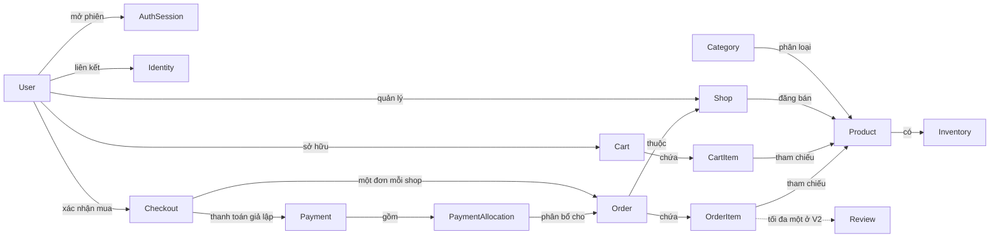
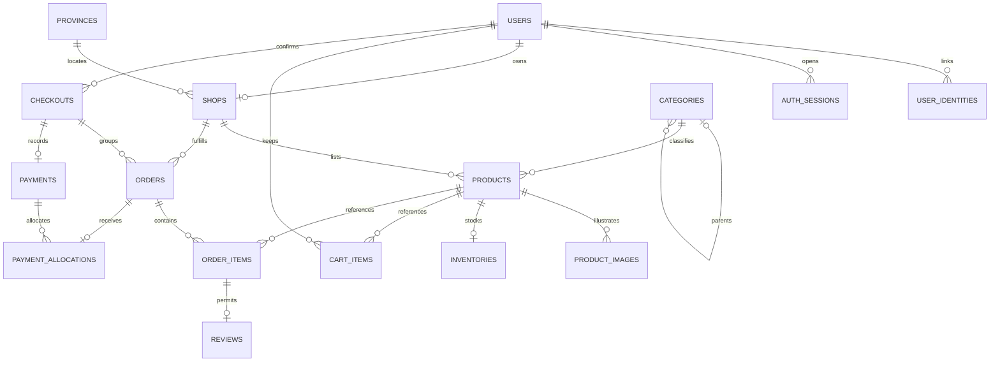
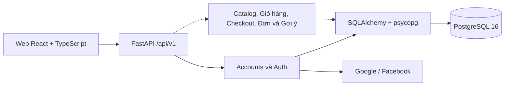

# Báo cáo tuần 12 – Thiết kế API sàn thương mại điện tử

Đối chiếu với nhánh `main` tại commit `6a3acd2` ngày 25/11/2026. Backend hiện phục vụ chức năng tài khoản và phiên đăng nhập. Các phần nghiệp vụ còn lại được mô tả theo tài liệu thiết kế và đặc tả hiện có.

## 1. Bài toán, người dùng và phạm vi

Người mua trên sàn cần tìm sản phẩm phù hợp với ngân sách, mua hàng từ nhiều cửa hàng trong một lần xác nhận và theo dõi từng đơn sau khi mua. Người bán cần quản lý sản phẩm, tồn kho và các đơn thuộc cửa hàng của mình. Hệ thống gom các mặt hàng vào một giỏ, tách lượt mua thành từng đơn theo cửa hàng và cung cấp gợi ý sản phẩm dựa trên ngân sách và tình trạng còn hàng.

API phục vụ **frontend web React** cho ba vai trò. Người mua (`buyer`) tìm và đặt hàng, người bán (`seller`) quản lý gian hàng và xử lý đơn, quản trị viên (`admin`) quản lý danh mục. Phạm vi tuần này tập trung vào web. Ứng dụng mobile và tích hợp API cho đối tác nằm ngoài phạm vi.

| Use case chính | Kết quả mong muốn | Trạng thái |
| --- | --- | --- |
| B01 – Truy cập tài khoản | Đăng ký, đăng nhập, xem tài khoản và quản lý phiên. Hỗ trợ email/mật khẩu, Google và Facebook. | Có API và giao diện web. Google/Facebook cần cấu hình nhà cung cấp để thử từ trình duyệt. |
| B02–B04 – Khám phá sản phẩm | Tìm theo từ khóa, lọc theo danh mục, khoảng giá, thương hiệu hoặc tỉnh/thành của cửa hàng. Xem gợi ý theo ngân sách và quản lý tùy chọn cá nhân hóa. | Có yêu cầu nghiệp vụ và mô hình dữ liệu. Chưa có API phục vụ luồng này. |
| B05–B06 – Mua hàng từ nhiều cửa hàng | Thêm sản phẩm vào giỏ, xác nhận mua một lần, nhận một đơn cho mỗi cửa hàng và một khoản thanh toán giả lập. | Có đặc tả Checkout và Payment. Chưa có API giỏ hàng, checkout hoặc thanh toán chạy được. |
| B07, S03 – Theo dõi và xử lý đơn | Người mua theo dõi hoặc hủy đơn đủ điều kiện. Người bán xem và cập nhật tiến độ giao đơn của cửa hàng mình. | Có đặc tả Orders. Chưa có API hoặc giao diện xử lý đơn. |
| S01–S02, A01 – Quản lý hàng bán và danh mục | Người bán đăng hoặc cập nhật hàng bán và tồn kho. Quản trị viên duy trì cây danh mục. | Có mô hình dữ liệu và đặc tả Inventory. Chưa có API quản lý sản phẩm hoặc danh mục trong OpenAPI. |

**Luồng demo cho các tuần sau.** Chọn luồng mua hàng từ hai cửa hàng. Người mua đăng nhập, thêm một sản phẩm từ mỗi cửa hàng vào giỏ và xác nhận mua. Theo đặc tả, server kiểm tra lại giá và tồn kho, tạo hai đơn và một thanh toán giả lập. Sau khi thanh toán thành công, người mua xem hai đơn và có thể hủy một đơn đủ điều kiện. Kịch bản kiểm thử gồm giá thay đổi, một sản phẩm thiếu hàng và gửi lại cùng `Idempotency-Key`. Khi thiếu hàng, toàn bộ giao dịch checkout phải được hoàn tác. Khi gửi lại cùng khóa và nội dung, hệ thống phải trả kết quả cũ, giữ nguyên số đơn và số lượng tồn kho sau lần mua đầu.

**MVP (V1).** Tài khoản, danh mục và hàng bán, tìm kiếm, gợi ý theo ngân sách kèm tùy chọn cá nhân hóa, giỏ đa cửa hàng, tồn kho, checkout, thanh toán giả lập, theo dõi, giao và hủy đơn. Gợi ý dự phòng dùng sản phẩm phổ biến đáp ứng điều kiện còn hàng, đang bán và nằm trong ngân sách nếu người mua có nhập.

**Ngoài MVP.** Trợ lý mua sắm dạng chat, đánh giá sau mua, bộ lọc theo điểm và kiểm duyệt đánh giá hoặc sản phẩm được xếp vào V2. Thanh toán thật, đối soát và chi trả cho cửa hàng nằm ngoài V1.

[Use case người mua](../docs/Use_Cases.md#buyer) · [Use case người bán](../docs/Use_Cases.md#seller) · [Use case quản trị viên](../docs/Use_Cases.md#admin) · [Yêu cầu V1](../docs/Requirements.md#v1--first-release) · [Phạm vi V2](../docs/Requirements.md#v2--deferred) · [Giả định phạm vi](../docs/Assumptions.md)

Luồng demo là đề xuất của báo cáo, dựa trên B05–B07 và S03. Có thể đối chiếu các hành vi đổi giá, thiếu hàng, chống tạo đơn trùng và hủy đơn trong đặc tả nghiệp vụ và hợp đồng HTTP. [Đặc tả giỏ hàng, checkout và xử lý đơn](../docs/Specifications.md#cart-checkout-and-fulfillment) · [OpenAPI – tạo checkout và các mã xung đột](../apps/backend/openapi.yaml#L263-L330) · [OpenAPI – hủy đơn](../apps/backend/openapi.yaml#L433-L453)

## 2. Resource model và kiến trúc

### 2.1. Tài nguyên và định danh

| Tài nguyên | Định danh và quan hệ |
| --- | --- |
| `User`, `AuthSession`, `Identity` | Người dùng và phiên có UUID. `/users/me` trỏ đến người dùng đã xác thực, `/auth/sessions/current` trỏ đến phiên hiện tại. Danh tính xã hội của một người dùng được truy cập theo `provider`. Hệ thống nhận diện tài khoản bên ngoài bằng cặp `(provider, provider_subject)`. |
| `Shop`, `Category`, `Product`, `Inventory` | Shop, Category và Product có UUID. Mỗi sản phẩm là một mặt hàng do một shop đăng trong một danh mục. Danh mục có thể có danh mục cha. Tồn kho được định danh theo `product_id`. |
| `Cart`, `CartItem` | Giỏ thuộc người mua. Một dòng giỏ được nhận diện bằng cặp `(user_id, product_id)`. Cấu trúc URL giỏ hàng chưa được đặc tả. |
| `Checkout`, `Order`, `OrderItem` | Có UUID riêng. Một checkout thuộc một người mua và chứa một đơn cho mỗi shop. Mỗi đơn có các dòng hàng giữ tên và đơn giá tại thời điểm đặt. |
| `Payment`, `PaymentAllocation` | Checkout có một khoản thanh toán giả lập theo đặc tả. API trả các phân bổ lồng trong Payment và dùng `order_id` để chỉ đơn nhận phân bổ. |
| `Review` (V2) | Có UUID. Một dòng hàng đã mua được gửi tối đa một đánh giá sau khi đơn hoàn tất. |

URL dùng chữ thường, danh từ số nhiều cho tập tài nguyên và `kebab-case` cho tên ghép, ví dụ `/order-items/{order_item_id}/review`. Tài nguyên con đơn nhất như `payment`, `inventory` và `cancellation` dùng số ít. Tham số truy vấn và trường JSON dùng `snake_case`. Giá và số tiền dùng số nguyên VND.

[Quy ước URL và truy vấn](../apps/backend/openapi.yaml#L8-L11) · [Schema số tiền và các định danh](../apps/backend/openapi.yaml#L826-L856)



### 2.2. ERD của các bảng chính



Resource model mô tả những gì client đọc hoặc thao tác qua API. Database schema định nghĩa bảng, khóa và ràng buộc lưu trữ. Ví dụ, tài nguyên giỏ hàng được tổng hợp từ `cart_items` với khóa ghép `(user_id, product_id)`. Phản hồi `Checkout` lồng các đơn và thanh toán, còn PostgreSQL lưu chúng trong `checkouts`, `orders`, `order_items`, `payments` và `payment_allocations`. Các ràng buộc `UNIQUE (buyer_id, idempotency_key)` và `UNIQUE (checkout_id, shop_id)` giúp bảo vệ quy tắc chống tạo lượt mua và đơn trùng. Trong API tài khoản, `providers` được tổng hợp từ `user_identities`, còn thông tin băm mật khẩu và refresh token chỉ dùng ở backend.

[ERD đầy đủ](../docs/ERD.drawio) · [Từ điển dữ liệu](../docs/Database_Tables.md) · [Migration – tài khoản và phiên](../apps/backend/migrations/001_initial_commerce.sql#L5-L36) · [Migration – giỏ hàng và ràng buộc checkout](../apps/backend/migrations/001_initial_commerce.sql#L89-L149) · [Migration – thanh toán và đánh giá](../apps/backend/migrations/001_initial_commerce.sql#L152-L189)

### 2.3. Kiến trúc và công nghệ



Backend dùng FastAPI trên Uvicorn, với Pydantic kiểm tra dữ liệu vào và định dạng phản hồi. Các module nghiệp vụ dùng chung PostgreSQL 16, truy cập qua SQLAlchemy và psycopg. Docker Compose khởi động PostgreSQL và chạy migration khi khởi tạo volume lần đầu. Frontend dùng React, TypeScript và Vite. Đường nét đứt trong sơ đồ biểu thị các module nghiệp vụ dự kiến kết nối qua API.

Thiết kế sử dụng Mermaid, Draw.io và OpenAPI viết trước. Nhánh có Swagger UI để đọc đặc tả và thử các route đã triển khai. Bộ công cụ kiểm thử gồm pytest, FastAPI TestClient, openapi-spec-validator và Vitest. Các ca kiểm thử sẵn có bao phủ xác thực, mô hình dữ liệu và một số kiểm tra hợp đồng OpenAPI.

[Sơ đồ kiến trúc mục tiêu](../docs/marketplace-architecture.mmd) · [Cấu hình PostgreSQL và migration](../docker-compose.yml#L1-L19) · [Kết nối SQLAlchemy và psycopg](../apps/backend/src/db.py) · [Thư viện backend](../apps/backend/requirements.txt) · [Thư viện frontend](../apps/web/package.json)

## 3. API contract và OpenAPI

Các đường dẫn trong hai bảng bên dưới đều có tiền tố `/api/v1`. Body và phản hồi thành công có dữ liệu dùng JSON. Dấu **—** biểu thị mục không áp dụng. Các mã HTTP trong bảng lấy theo từng operation trong OpenAPI. Tên schema trỏ đến định nghĩa trong `components/schemas` của tệp YAML.

### 3.1. Accounts và Auth đã triển khai

| Method | Path | Tham số | Request body | Phản hồi thành công | Mã lỗi theo OpenAPI |
| --- | --- | --- | --- | --- | --- |
| POST | `/users` | — | `RegisterRequest` gồm `email`, `password`, `full_name` | `201 AuthSession` | 400, 409, 422, 429 |
| GET | `/users/me` | Bearer | — | `200 User` | 401 |
| POST | `/users/me/identities` | Bearer | `provider` (google hoặc facebook), `credential` | `201 User` | 401, 409, 422, 503 |
| DELETE | `/users/me/identities/{provider}` | Bearer, `provider` (google hoặc facebook) | — | `204` | 401, 404, 409 |
| POST | `/auth/sessions` | — | `LoginRequest` gồm `email`, `password` | `201 AuthSession` | 401, 422, 429 |
| POST | `/auth/sessions/google` | — | `credential` (Google ID token) | `201 AuthSession` | 401, 429, 503 |
| POST | `/auth/sessions/facebook` | — | `access_token` (Facebook access token) | `201 AuthSession` | 401, 409, 422, 429, 503 |
| DELETE | `/auth/sessions/current` | Bearer | — | `204` | 401 |
| POST | `/auth/tokens` | Cookie `refresh_token` | — | `200 AuthSession` | 401 |

`User` có `id`, `email`, `full_name`, `role`, `created_at`, `providers` và `has_password`. `AuthSession` có `access_token`, `token_type`, `expires_in` (giây) và `user`. Backend gửi refresh token qua `Set-Cookie`. Phản hồi `204` có body rỗng.

[OpenAPI – Accounts/Auth](../apps/backend/openapi.yaml#L30-L262) · [Route và cách đặt cookie](../apps/backend/src/accounts/routes.py#L15-L106) · [Schema Pydantic](../apps/backend/src/accounts/schema.py)

### 3.2. Checkout, thanh toán, đơn hàng, tồn kho và đánh giá đã có đặc tả

Các tham số `*_id` trong URL là UUID bắt buộc. Cột tham số liệt kê path, query và header riêng của operation. Các operation trong bảng yêu cầu Bearer token, ngoại trừ danh sách đánh giá công khai của sản phẩm.

| Method | Path | Tham số | Request body | Phản hồi thành công | Mã lỗi theo OpenAPI |
| --- | --- | --- | --- | --- | --- |
| POST | `/checkouts` | Header `Idempotency-Key` bắt buộc (1–64 ký tự) | `CheckoutRequest` | `201 Checkout` khi tạo mới, `200 Checkout` khi gửi lại cùng khóa và nội dung | 400, 401, 403, 409, 422 |
| GET | `/checkouts/{checkout_id}` | `checkout_id` | — | `200 Checkout` | 401, 403, 404 |
| GET | `/checkouts/{checkout_id}/payment` | `checkout_id` | — | `200 Payment` | 401, 403, 404 |
| POST | `/checkouts/{checkout_id}/payment-attempts` | `checkout_id` | Tùy chọn `simulate` (succeeded hoặc failed, mặc định succeeded) | `200 Payment` | 401, 403, 404, 409 |
| GET | `/orders` | Query `status`, `limit`, `cursor` | — | `200 OrderPage` | 401, 422 |
| GET | `/orders/{order_id}` | `order_id` | — | `200 Order` | 401, 403, 404 |
| POST | `/orders/{order_id}/cancellation` | `order_id` | — | `200 Order` | 401, 403, 404, 409 |
| POST | `/orders/{order_id}/shipment` | `order_id` | — | `200 Order` | 401, 403, 404, 409 |
| POST | `/orders/{order_id}/completion` | `order_id` | — | `200 Order` | 401, 403, 404, 409 |
| GET | `/shops/me/orders` | Query `status`, `limit`, `cursor` | — | `200 OrderPage` | 401, 403, 422 |
| GET | `/products/{product_id}/inventory` | `product_id` | — | `200 Inventory` | 401, 403, 404 |
| PUT | `/products/{product_id}/inventory` | `product_id` | `quantity` nguyên, từ 0 trở lên | `200 Inventory` | 401, 403, 404, 422 |
| GET | `/products/{product_id}/reviews` | `product_id`, query `limit`, `cursor` | — | `200 ReviewPage` | 404, 422 |
| POST | `/order-items/{order_item_id}/review` | `order_item_id` | `ReviewRequest` gồm `rating` từ 1–5, `content` tùy chọn | `201 Review` | 401, 403, 404, 409, 422 |
| PATCH | `/reviews/{review_id}` | `review_id` | Ít nhất một trường `rating` hoặc `content` | `200 Review` | 401, 403, 404, 422 |
| DELETE | `/reviews/{review_id}` | `review_id` | — | `204` | 401, 403, 404 |
| PUT | `/reviews/{review_id}/visibility` | `review_id` | `status` (visible hoặc hidden) | `200 Review` | 401, 403, 404, 422 |
| GET | `/users/me/reviews` | Query `limit`, `cursor` | — | `200 ReviewPage` | 401, 422 |

- `CheckoutRequest` bắt buộc có `items` (ít nhất một dòng gồm `product_id`, `quantity ≥ 1`, `expected_unit_price`) và `shipping` (gồm `name`, `phone`, `address`).
- `Checkout` có `id`, `total_amount`, `created_at`, `orders` và `payment`. `Order` mô tả shop, trạng thái, tổng tiền, thông tin giao hàng, các dòng hàng và các mốc xử lý. `Payment` mô tả trạng thái, số tiền, số tiền hoàn, số lần thử và các phân bổ theo đơn.
- `Inventory` có `product_id`, `quantity`, `updated_at`. `Review` có định danh, tham chiếu sản phẩm và dòng hàng, tên hiển thị tác giả, điểm, nội dung, trạng thái và thời gian.

[OpenAPI – Checkout và Payments](../apps/backend/openapi.yaml#L263-L397) · [OpenAPI – Orders](../apps/backend/openapi.yaml#L398-L508) · [OpenAPI – Inventory](../apps/backend/openapi.yaml#L509-L551) · [OpenAPI – Reviews](../apps/backend/openapi.yaml#L552-L686) · [Schema phản hồi](../apps/backend/openapi.yaml#L826-L943)

### 3.3. Định dạng lỗi, phân trang, lọc và sắp xếp

Backend dùng `application/problem+json` theo RFC 9457. Phản hồi có `type`, `title`, `status`, `detail` và `instance`. Lỗi kiểm tra dữ liệu `422` có thêm `errors`, mỗi phần tử gồm `field` và `message`. Ví dụ khi đăng ký với email sai định dạng:

```json
{
  "type": "/problems/validation-error",
  "title": "Unprocessable Content",
  "status": 422,
  "detail": "Dữ liệu gửi lên không hợp lệ.",
  "instance": "/api/v1/users",
  "errors": [
    {"field": "email", "message": "Email không hợp lệ."}
  ]
}
```

`401` chỉ lỗi xác thực, `403` chỉ thiếu quyền, `404` chỉ tài nguyên không tồn tại và `409` chỉ xung đột như trùng email hoặc chuyển trạng thái đơn không hợp lệ. Lỗi giới hạn đăng ký/đăng nhập `429` có `Retry-After`. Đặc tả checkout dành hai trường mở rộng cho `409`: `changes` khi giá đã đổi và `products` khi thiếu hàng.

Danh sách đơn và đánh giá trong đặc tả dùng phân trang cursor. Client gửi `limit` từ 1 đến 100 (mặc định 20) và lấy `next_cursor` từ phản hồi `{items, next_cursor}` để đọc trang tiếp theo. `next_cursor` là `null` khi hết dữ liệu. Hai danh sách đơn hỗ trợ lọc `status` và sắp xếp mới nhất trước. Lịch sử đơn của người mua dùng cặp `(created_at, id)` cho cursor. Danh sách đánh giá công khai của sản phẩm hiển thị đánh giá mới nhất trước và chỉ trả trạng thái `visible`. Đặc tả hiện chưa có tham số tùy chọn thứ tự sắp xếp hoặc endpoint tìm kiếm sản phẩm.

[Bộ xử lý lỗi FastAPI](../apps/backend/src/common/errors.py#L33-L91) · [Ca kiểm thử lỗi đăng ký](../apps/backend/tests/test_auth_api.py#L68-L92) · [Tham số lọc và phân trang](../apps/backend/openapi.yaml#L703-L717) · [Lịch sử đơn](../apps/backend/openapi.yaml#L398-L415) · [Danh sách đánh giá của sản phẩm](../apps/backend/openapi.yaml#L552-L568)

### 3.4. Xác thực, phân quyền và phiên bản

- **Xác thực.** API đã dùng JWT Bearer cho route được bảo vệ, mặc định hết hạn sau 15 phút. Claim `sid` liên kết với phiên trong DB để kiểm tra hiệu lực trên mỗi request. Refresh token nằm trong cookie `HttpOnly; SameSite=Lax` và được xoay vòng khi làm mới. Đăng xuất thu hồi phiên hiện tại.
- **Phân quyền.** Nhánh có ba vai trò `buyer`, `seller`, `admin` và dependency kiểm tra vai trò. Đề xuất áp dụng kiểm tra quyền sở hữu cùng với vai trò khi triển khai nghiệp vụ. Buyer thao tác trên lượt mua của mình, seller sửa tồn kho và cập nhật giao hàng cho shop của mình, admin quản lý danh mục và kiểm duyệt. Theo đặc tả, buyer của đơn hoặc seller sở hữu shop có thể hủy đơn đủ điều kiện.
- **Phiên bản.** API đã dùng tiền tố `/api/v1` và đặc tả khai báo phiên bản `1.0.0`. Đề xuất giữ `/api/v1` cho các thay đổi tương thích và dùng phiên bản đường dẫn mới khi cần thay đổi hợp đồng làm client hiện tại phải sửa. V1/V2 trong phạm vi nghiệp vụ là các mốc phát hành chức năng.

[Cấu hình thời hạn token](../apps/backend/src/config.py#L6-L17) · [Kiểm tra xác thực và phiên](../apps/backend/src/accounts/authentication.py#L135) · [Kiểm tra vai trò](../apps/backend/src/accounts/permissions.py#L8) · [OpenAPI – xác thực và phiên bản](../apps/backend/openapi.yaml#L1-L19)

### 3.5. Tệp đặc tả và Swagger UI

Nhánh đã có đặc tả OpenAPI 3.0.3 với **25 path và 27 operation**. Trong đó, **9 operation** Accounts/Auth đã được đăng ký vào FastAPI. **18 operation** còn lại mô tả Checkout, Payments, Orders, Inventory và Reviews. [Tệp openapi.yaml](../apps/backend/openapi.yaml) · [Router đang được đăng ký](../apps/backend/src/app.py#L38-L49)

Sau khi khởi động backend cục bộ, mở Swagger UI tại `http://localhost:5000/api/v1/docs`. Trang đọc YAML từ `GET /api/v1/openapi.yaml`. Có thể thử các endpoint Accounts/Auth trong Swagger UI. Các operation nghiệp vụ còn lại có thể xem hợp đồng nhưng chưa gọi được trong ứng dụng hiện tại. [Hướng dẫn khởi động backend](../apps/backend/README.md#chạy-backend-fastapi) · [Mã nguồn hai route tài liệu](../apps/backend/src/app.py#L55-L67)

### 3.6. Các phần còn thiếu trên nhánh

- Catalog và cây danh mục, tìm kiếm, giỏ hàng, gợi ý, tùy chọn cá nhân hóa và chat chưa có operation trong OpenAPI hiện tại. Tồn kho, checkout, thanh toán, xử lý đơn và đánh giá đã có đặc tả nhưng chưa có route chạy được.
- Frontend hiện có trang đăng nhập, đăng ký và tài khoản. Các màn hình mua hàng, quản lý shop, xử lý đơn và quản trị danh mục chưa được triển khai.
- Luồng demo mua hàng đa cửa hàng chưa chạy được từ đầu đến cuối. Báo cáo tiến độ của nhóm ghi nhận các bài kiểm thử xác thực xã hội dùng dữ liệu giả lập. Việc thử Google/Facebook với tài khoản thật cần cấu hình môi trường.

[Tệp đăng ký router FastAPI](../apps/backend/src/app.py) · [Định tuyến frontend](../apps/web/src/App.tsx) · [Tiến trình dự án](../docs/Progress.md)

## 4. Bằng chứng kiểm thử

Kết quả dưới đây được chạy lại trên mã nguồn của nhánh `main`. Backend được thử với một PostgreSQL 16 tạm đã chạy các migration của dự án.

| Hạng mục | Kết quả quan sát | Nguồn để đối chiếu |
| --- | --- | --- |
| Backend | **61 ca đạt**, gồm đăng ký, đăng nhập, làm mới token, thu hồi phiên, kiểm tra quyền, các ràng buộc dữ liệu và hợp đồng API. | [Kiểm thử xác thực](../apps/backend/tests/test_auth_api.py#L47-L163) · [Kiểm thử ràng buộc dữ liệu](../apps/backend/tests/test_entities.py) · [Đối chiếu ORM với PostgreSQL](../apps/backend/tests/test_schema_sync.py) |
| Hợp đồng OpenAPI | **4 ca đạt** trong bộ kiểm thử backend. Các ca này kiểm tra tính hợp lệ của YAML, đối chiếu route Accounts/Auth với đặc tả và kiểm tra kiểu nội dung lỗi. | [Các ca kiểm thử hợp đồng](../apps/backend/tests/test_openapi_contract.py#L36-L55) |
| Frontend | **42 ca đạt trong 5 tệp Vitest**. Lệnh kiểm tra kiểu TypeScript cũng kết thúc thành công. | [Kiểm thử giao diện đăng ký/đăng nhập](../apps/web/src/shared/auth/__tests__/pages.test.tsx) · [Kiểm thử phiên](../apps/web/src/shared/auth/__tests__/session.test.tsx) · [Các lệnh trong package.json](../apps/web/package.json#L6-L11) |

Khi gửi request trực tiếp vào ứng dụng bằng FastAPI TestClient, kết quả thu được như sau. Phản hồi HTML có mã khởi tạo Swagger UI và trỏ đúng đến route YAML. Việc hiển thị giao diện sau khi trình duyệt tải JavaScript từ CDN nằm ngoài lần kiểm thử này. [Mã nguồn các route được thử](../apps/backend/src/app.py#L51-L67)

```text
GET /healthz              → 200 application/json
GET /api/v1/openapi.yaml  → 200 application/yaml
GET /api/v1/docs          → 200 text/html
GET /api/v1/users/me      → 401 application/problem+json (không gửi bearer token)
```

Kiểm thử Google dùng token ký cục bộ và chứng chỉ giả lập. Kiểm thử Facebook dùng phản hồi Graph API giả lập. Các kịch bản này kiểm tra xử lý ở backend. Việc đăng nhập với tài khoản thật cần cấu hình riêng của nhà cung cấp. [Kiểm thử xác minh token Google](../apps/backend/tests/test_google_real_verification.py) · [Kiểm thử Facebook](../apps/backend/tests/test_auth_api.py#L287) · [Hướng dẫn cấu hình](../apps/backend/README.md#bật-đăng-nhập-google--facebook)

Để chạy lại, chuẩn bị PostgreSQL test và biến môi trường theo hướng dẫn backend. Từ thư mục `e-commerce`, chạy `python -m pytest -q -p no:cacheprovider apps/backend/tests`. Từ `e-commerce/apps/web`, chạy `npm run test` và `npm run typecheck` sau khi cài các gói frontend. [Chuẩn bị backend](../apps/backend/README.md) · [Chuẩn bị frontend](../apps/web/README.md)
